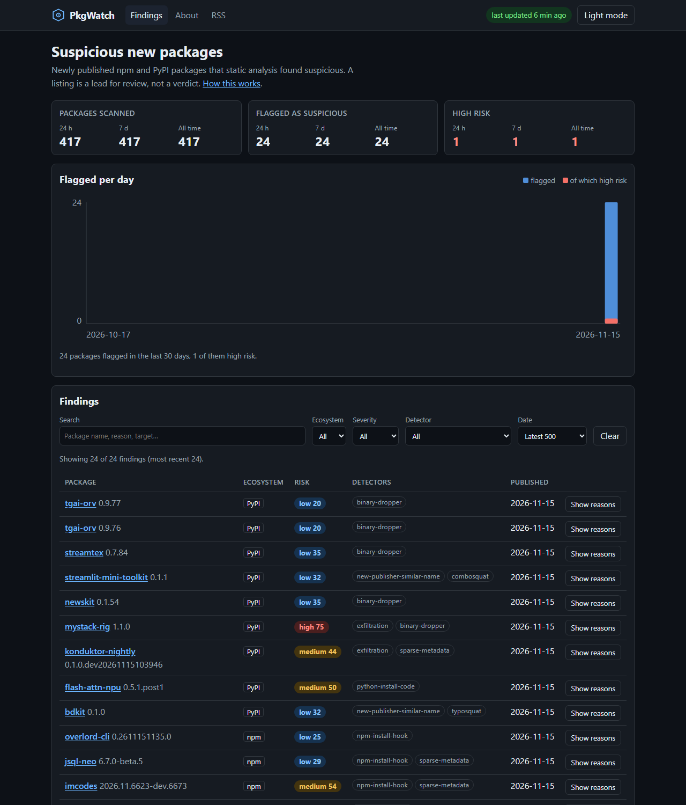
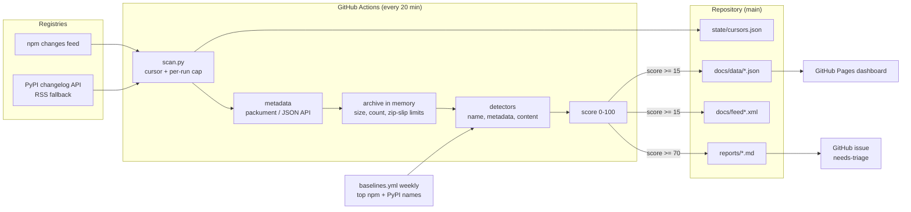

# PkgWatch

**PkgWatch watches newly published packages on npm and PyPI, analyses them statically for
supply-chain attack indicators, and publishes what looks suspicious to a public dashboard
with JSON and RSS feeds.**

It runs entirely on GitHub Actions cron: no servers, no databases, no paid APIs, no API
keys beyond the built-in `GITHUB_TOKEN`. Packages are never installed, imported or executed.

- Dashboard: <https://abidranesh.github.io/typosquat_-_mal_package_tracker/>
- Feeds: [`feed.xml`](https://abidranesh.github.io/typosquat_-_mal_package_tracker/feed.xml) (everything listed) and [`feed-high.xml`](https://abidranesh.github.io/typosquat_-_mal_package_tracker/feed-high.xml) (high risk only)
- Data: [`docs/data/latest.json`](docs/data/latest.json), [`docs/data/stats.json`](docs/data/stats.json)



> **A listing is a lead, not a verdict.** PkgWatch calls packages *suspicious* and shows
> its reasons. It is automated pattern matching and it makes mistakes: installers, build
> tools and security scanners legitimately do many of the things an attack does. Every
> listing has a "Report a false positive" link.

## How it works



1. **Collect.** `scan.yml` runs every 20 minutes. It reads everything published since the
   cursors in `state/cursors.json`, capped at 2,000 packages and 12 minutes per run; the
   rest carries over.
2. **Fetch.** For each package it downloads the registry metadata and the archive (npm
   tarball; PyPI sdist and a wheel) into memory, with a 10 MB download limit, a 50 MB
   uncompressed limit, a 5,000-file limit, and rejection of absolute or `..` paths.
3. **Detect.** Fifteen detectors, each a pure function `(PackageContext) -> list[Finding]`,
   look at the name, the metadata and the file contents.
4. **Score.** Weights are summed and capped at 100. Scores of 15 or more are listed.
5. **Publish.** Listed findings go to `docs/data`, the RSS feeds and the dashboard. For
   scores of 70 or more a report is written to `reports/` and a GitHub issue labelled
   `needs-triage` is opened in this repository. **Nothing is ever reported to npm or PyPI
   automatically**; a human reads the issue and decides.

## Methodology

| Score | Level | Meaning |
|---|---|---|
| 70–100 | high | Several strong indicators together; a triage issue is opened |
| 40–69 | medium | One strong indicator, or weaker ones that reinforce each other |
| 15–39 | low | A single weak indicator; usually benign |
| 0–14 | not listed | Counted in aggregate statistics only |

All weights and thresholds are in [`pkgwatch/config.toml`](pkgwatch/config.toml).

| Finding id | Kind | What triggers it |
|---|---|---|
| `typosquat` | name | One or two edits (Damerau-Levenshtein) from a popular package; one edit only for names of five characters or fewer |
| `name-manipulation` | name | Separator changes, look-alike characters (`rn`/`m`, `1`/`l`, `0`/`o`), added prefixes or suffixes, npm scope confusion |
| `combosquat` | name | A popular name plus generic words (`lodash-helper`) |
| `dependency-confusion` | name | Internal-looking name at a very high version, or any first release at such a version |
| `new-publisher-similar-name` | metadata | Recently created package from a publisher with little history, with a name close to a popular one |
| `sparse-metadata` | metadata | Missing or placeholder description, README or repository link |
| `repo-impersonation` | metadata | Repository link points at the imitated package's repository |
| `popular-package-change` | metadata | New maintainer, or a big jump in size or version, on a popular package |
| `npm-install-hook` | content | `preinstall`, `install` or `postinstall` scripts; higher for shells, downloaders and bundled files |
| `python-install-code` | content | `setup.py` (parsed with `ast`) doing network, process, `exec`/`eval`, decoding or outside writes; install command overrides; executable `.pth` files |
| `obfuscation` | content | Decode-and-execute patterns, high-entropy strings, encoded blobs, character-code chains, minified code in a tiny package |
| `exfiltration` | content | Reads of credential, browser, chat-token or wallet files, or a dump of the environment, in a file that also uses the network |
| `suspicious-endpoint` | content | Hardcoded chat webhooks, tunnel and request-capture hosts, paste sites, raw-IP URLs |
| `binary-dropper` | content | Executables in a package not declared as native, or code that downloads a file and runs it |
| `unsafe-archive` | content | Archive entries with absolute or parent-directory paths |

Design choices, the reasoning behind the weights, and every place where reality differed
from the original plan are recorded in [`DECISIONS.md`](DECISIONS.md).

### Measuring the detectors

`tests/fixtures/` holds a synthetic corpus: stand-ins that imitate the *shape* of
documented attacks (install-hook droppers, base64-exec `setup.py`, token stealers,
typosquats of `requests`, `colorama`, `lodash`, `express`) and clean packages modelled on
real ones, including look-alikes of false positives found in live runs. The fixtures are
inert JSON, point only at `example.invalid`, and are never executed.

```bash
python -m pkgwatch.eval
```

prints precision and recall per finding id. CI fails if fewer than 90% of the malicious
fixtures score 40 or more, or if any clean fixture does.

## Run it locally

Requires Python 3.12.

```bash
python -m venv .venv
```

```bash
.venv/bin/python -m pip install -r requirements-dev.txt
```

(On Windows the interpreter is `.venv\Scripts\python.exe`.)

```bash
python -m pkgwatch.scan --dry-run --limit 50
```

A dry run reads the live registries, ignores and does not save the cursors, opens no
issues, and writes its output to `./dry-run-out`. Useful flags: `--ecosystem npm|pypi`,
`--output-dir`, `--reports-dir`, `--no-issues`.

To view the dashboard, serve `docs/` with any static server:

```bash
python -m http.server 8000 --directory docs
```

Checks that CI runs:

```bash
ruff check . && ruff format --check .
```

```bash
pytest --cov=pkgwatch --cov-fail-under=85
```

```bash
python -m pkgwatch.eval && python scripts/check_site.py
```

`python scripts/probe_sources.py` probes every upstream endpoint and prints what it
returns today, which is the first thing to run if a source starts failing.

## Repository layout

```
pkgwatch/
  config.toml            weights, thresholds, limits
  http.py                client: User-Agent, timeouts, size caps, backoff
  archive.py             safe in-memory tar/zip/wheel reading
  sources/               npm.py, pypi.py, baselines.py
  detectors/             names, metadata, install_hooks, python_ast,
                         obfuscation, exfil, binaries
  scoring.py             run detectors, sum weights
  output/                json_out, rss, reports, issues
  scan.py                entrypoint
  eval.py                fixture evaluation
data/baselines/          popular-package snapshots (refreshed weekly)
state/                   cursors and de-duplication hashes
docs/                    GitHub Pages root: dashboard, data, feeds
reports/                 report text for high findings
tests/                   unit tests and the fixture corpus
scripts/                 fixture generator, source probe, site checks
```

## Workflows

| Workflow | Schedule | Purpose |
|---|---|---|
| `scan.yml` | every 20 minutes | Scan, commit changed data as `pkgwatch-bot`, open triage issues |
| `baselines.yml` | weekly | Refresh the popular-package lists |
| `keepalive.yml` | monthly | No-op commit so GitHub does not disable the schedules |
| `ci.yml` | push, pull request | Lint, format, tests (85% coverage floor), evaluation, site checks |

A scan that cannot read a registry, or in which more than 30% of packages fail, exits
non-zero so the workflow fails and GitHub notifies the owner. `docs/data/health.json` is
only rewritten on success; the dashboard shows its age and turns the badge red after two
hours.

### One-time setup on GitHub

1. **Settings → Actions → General → Workflow permissions:** choose "Read and write
   permissions".
2. **Settings → Pages:** source "Deploy from a branch", branch `main`, folder `/docs`.
3. The `needs-triage` label is created by the first scan that needs it. The
   `false-positive` and `detector-idea` labels used by the issue templates must be created
   by hand (**Issues → Labels**).

## Contributing a detector

See [`CONTRIBUTING.md`](CONTRIBUTING.md). In short: add a pure function to a module in
`pkgwatch/detectors/`, register its finding id and weight, add a malicious fixture, a clean
fixture and a near-miss, and make `python -m pkgwatch.eval` pass.

## Limitations

- **Static analysis only.** Code that hides its behaviour well, or only misbehaves under
  runtime conditions, is missed. Heuristics can also be evaded by anyone who reads them.
- **False positives are expected**, especially at the low level. Installers and developer
  tools download and run things; security tools mention credential paths.
- **Large packages are only partly examined.** Archives over the size limits are scored on
  name and metadata alone, and pattern detectors read at most 4 MB of code per package.
- **Publisher age is an estimate.** Neither registry publishes account creation dates.
- **Coverage is best-effort.** GitHub's cron can be delayed or skipped; after a long outage
  the scanner skips ahead rather than replaying days of backlog.
- **Not being listed means nothing.** Unlisted packages were not vetted, only not flagged.
- **Git history grows** with every data commit. See `DECISIONS.md` for how to trim it.

## Security and licence

To report a vulnerability in PkgWatch itself, see [`SECURITY.md`](SECURITY.md).
Licensed under the [MIT License](LICENSE).
